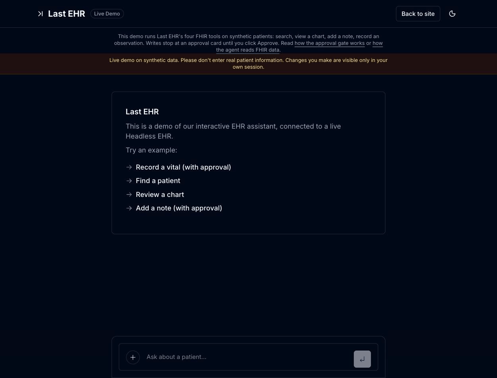
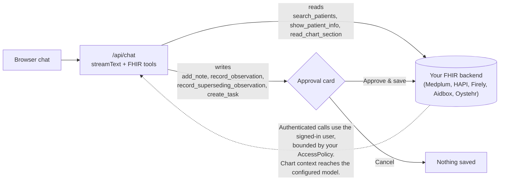

# Last EHR

[](https://github.com/cbetz/last-ehr/actions/workflows/ci.yml)
[](LICENSE)
[](https://www.npmjs.com/package/@lastehr/mcp)
[](https://www.npmjs.com/package/@lastehr/agent-write-conformance)
[](https://registry.modelcontextprotocol.io/?q=io.github.cbetz%2Flast-ehr)

**Status: early / alpha.** Use synthetic data only. License: [Apache-2.0](./LICENSE).

## Works with Epic and Oracle Health sandboxes

Last EHR can be the approval gate in front of the Epic FHIR sandbox and the
Oracle Health secure sandbox. The human sees the Observation those servers
accepted (Epic flowsheet code plus encounter, Oracle legal-authenticator
performer and an allowlisted vital), and the agent gets a read-back diff
after the save. Synthetic sandbox patients only. This is not a clinical or
compliance claim. The adapters stay behind
`LASTEHR_EXPERIMENTAL_FHIR_ADAPTERS=1` because those sandboxes do not
support delete: an approved write persists, and the safety eval cannot
clean up. Ten-minute setup is in
[docs/adapters/epic-cerner.md](./docs/adapters/epic-cerner.md).

```bash
export LASTEHR_EXPERIMENTAL_FHIR_ADAPTERS=1
export FHIR_BACKEND=epic
export LASTEHR_CLIENT_ID='your-non-production-client-id'
export LASTEHR_PRIVATE_KEY_PATH="$PWD/lastehr-sandbox.pem"
export LASTEHR_KEY_ID='lastehr-epic-1'
export LASTEHR_ENCOUNTER='Encounter/eMT95RPaM-HxLc3NeIA5qlQ3'
```

Then ask: `Record a heart rate of 72 bpm for patient erXuFYUfucBZaryVksYEcMg3`.
The card shows flowsheet code `8` and LOINC `8867-4` before anything is
saved. Oracle uses `FHIR_BACKEND=oracle-health`, `LASTEHR_SCOPES`, and an
oral temperature (`8331-1`) with `LASTEHR_PERFORMER`.

The same sandboxes are wired into `@lastehr/mcp` `0.5.1` in this checkout.
That version is prepared and not published; npm `latest` below is still
the last published package. From a checkout:

```bash
npx tsx packages/mcp/src/cli.ts init --backend epic
npx tsx scripts/sandbox-proof
```

`init --backend epic` or `oracle` prints placeholder env
(`LASTEHR_BACKEND`, `LASTEHR_CLIENT_ID`, `LASTEHR_PRIVATE_KEY_PATH`,
`LASTEHR_KEY_ID`, `LASTEHR_JWKS_URL`, and `LASTEHR_ENCOUNTER` or
`LASTEHR_PERFORMER` plus `LASTEHR_SCOPES` for Oracle) and the setup steps.
`doctor` checks the key, JWKS kid, token exchange, granted scopes, and
search scope without printing secrets.

## Start here

The first step is the published package. It does not create an account.

```bash
npx -y @lastehr/mcp init
```

npm `latest` is `@lastehr/mcp@0.4.1`. The JSON this command prints must list
`@lastehr/mcp@0.4.1` in `args`. If it names another version, stop and run
`npx -y @lastehr/mcp@0.4.1 init` instead. This page describes that release.
`init` in 0.4.1 accepts `--client json` (the default), `claude-code`, or
`cursor`. It prints a client configuration and exits. It does not start a
server, register the client, or contact a FHIR endpoint, and it has no flag
that selects a hosted demo.

Default output:

```json
{
  "mcpServers": {
    "lastehr": {
      "command": "npx",
      "args": ["-y", "@lastehr/mcp@0.4.1"],
      "env": {
        "MEDPLUM_ACCESS_TOKEN": "<replace-with-a-least-privilege-token>"
      }
    }
  }
}
```

`--client cursor` adds `"type": "stdio"`. `--client claude-code` prints
`claude mcp add lastehr -- npx -y @lastehr/mcp@0.4.1` plus comments. The
generated command is pinned to the version that ran `init`.

### No-account synthetic backend

The no-account backend 0.4.1 accepts is this repository's local HAPI stack.
Set `FHIR_BACKEND=hapi` and `FHIR_BASE_URL` or `HAPI_BASE_URL`. No Medplum
token. The stack has no auth, Compose binds it to loopback, and it is for
synthetic records only.

Node 22.18+ (or 24.2+) and a running Docker daemon:

```bash
git clone https://github.com/cbetz/last-ehr.git
cd last-ehr
npm install
npm run demo:local
```

`demo:local` starts HAPI and Postgres, seeds synthetic patients, and opens
the fixed walkthrough at <http://localhost:3000/demo>. It does not create or
read `.env.local`. The first image pull can take several minutes. Press
Ctrl-C to stop Next.js. `npm run demo:local:down` removes the stack.

In the configuration `init` printed, replace the `env` block with:

```json
"env": {
  "FHIR_BACKEND": "hapi",
  "FHIR_BASE_URL": "http://localhost:8080/fhir"
}
```

Keep the rest, including `"type": "stdio"` when `--client cursor` printed it.
Save it where the client reads MCP config (for Cursor,
`~/.cursor/mcp.json` or `.cursor/mcp.json`). With `FHIR_BACKEND=hapi`, 0.4.1
does not read `MEDPLUM_*`.

The Claude Code line does not carry those variables. Export them in the shell
that launches Claude Code:

```bash
export FHIR_BACKEND=hapi
export FHIR_BASE_URL=http://localhost:8080/fhir
```

After HAPI is up, this check prints no patient records:

```bash
FHIR_BACKEND=hapi FHIR_BASE_URL=http://localhost:8080/fhir npx -y @lastehr/mcp doctor --connect
```

In 0.4.1, `doctor --connect` checks FHIR R4 metadata and a count-only Patient
search. It does not check other resource permissions, writes, or a client's
approval UI.

`npm run mcp:demo` is a separate checkout-only lab, outside the published
`@lastehr/mcp@0.4.1` package. It exposes `search_patients` and
`show_patient_info` for four fixture patients. See the
[MCP guide](./docs/mcp.md).

Local stack failures: [Troubleshooting the local lab](./docs/quickstart.md#troubleshooting-the-local-lab).

## Other ways in

These are optional. The published MCP package and the local synthetic stack
above are the first path.

| Goal | Start here |
| --- | --- |
| Test an MCP (stdio) implementation of the write protocol | `npx @lastehr/agent-write-conformance` — [conformance guide](./docs/conformance.md) |
| Have an assistant draft synthetic work, then review it separately | `npm run work:demo` — [Assistant Work Lab](./docs/assistant-work.md). Add `--agent --model-env .env.local` only when a model key is already configured. |
| Connect an external MCP assistant to durable synthetic work | [Work MCP connector](./docs/work-mcp.md): `npm run --silent work:mcp -- --print-config` |
| Deploy the web app | [Quickstart](#quickstart): Vercel, with your own Medplum project and model key |
| Run the web app locally | [Quickstart](#quickstart): Medplum, or `npm run demo:local` for the fixed synthetic walkthrough |
| Open the hosted synthetic demo | <https://www.lastehr.com/demo> — no sign-up. Ask `Find patients named Smith`, then `Record a heart rate of 72 bpm for Maria Garcia`, and inspect the approval card before anything is saved. |
| Read the protocol | [Approval-Gated Agent Writes on FHIR, v0.1 draft](./docs/agent-write-protocol.md) |
| See the FHIR read surface | [FHIR coverage](./docs/fhir-coverage.md) |
| Inspect two read-only tools on four fixture patients | `npm run mcp:demo -- --client claude-code` from a checkout. Not the published package. |
| Connect native Grok Bot to synthetic work | [Grok Bot with Last EHR](./docs/grok-bot.md) |
| Deploy a dedicated synthetic Work service | [Hosted Synthetic Work](./docs/hosted-work.md) |
| Run the synthetic safety-mechanics check | `npm run eval` — [evaluation guide](./docs/evals.md). This checks proposal, approval, denial, and cleanup mechanics. |

## What it is

**Read the chart broadly. Write only what a human approved.** Last EHR is the
agent layer for a headless FHIR EHR. It does three things, and the write
protocol is only one of them.

**It reads the chart broadly.** 25 of [US Core 9.0.0](https://hl7.org/fhir/us/core/)'s
27 readable resource types, across 23 patient-scoped sections, following
references so authors, encounters, and provenance stop being dead pointers.
Counted in the open, with the ceiling published rather than implied, in
[FHIR coverage](./docs/fhir-coverage.md).

**It is built so the agent cannot fake an absence.** "She has never had a flu
shot" is the answer a chart agent must never invent, so a read reports when
its window was capped, when a reference lookup was refused, and when a code
filter matched nothing in a section that does hold records. Filters that a
section cannot apply are refused with the legal values instead of silently
dropped. These are safety-boundary tests, not best-effort behavior.

**Every write is a proposal.** Show the exact resource, require an explicit
human decision, commit exactly what was reviewed, and record what created it.
That half is a small protocol,
**[Approval-Gated Agent Writes on FHIR](./docs/agent-write-protocol.md)**
(v0.1 draft): Proposal → Decision → Commit → Audit. Two implementations run
here, a web approval card and MCP elicitation-gated write tools, plus a
[conformance suite](./docs/conformance.md) that checks implementations with
its own FHIR reads. Independent implementations and criticism are invited.

Five FHIR backends sit behind one interface. This repository is the reference
implementation: bring your own FHIR backend and model key for a real agent
(Medplum for the authenticated path, or any verified adapter for synthetic
evaluation), or start with the zero-key local synthetic walkthrough.

> **Last EHR is a _layer_, not an EHR.** It runs *on top of* a headless FHIR backend (Medplum for authenticated use; HAPI FHIR, Firely Server, Aidbox, or Oystehr for synthetic evaluation) and talks to it over the FHIR API. It is not the system of record and never bundles or forks the backend. The web agent has no separate chart database, but processes chart data and sends chart context to the configured model provider. The opt-in local Work Lab persists synthetic requests, run progress, proposals, and decisions. See the [HIPAA deployment groundwork](./docs/hipaa-deployment.md) before planning a clinical deployment.

**Status: early / alpha.** APIs, structure, and scope will change. Use synthetic data only. · License: [Apache-2.0](./LICENSE)

**[Try the live demo](https://www.lastehr.com/demo)**: no sign-up, synthetic data, and every write goes through the approval gate.



## What it does

- A chat agent (Vercel AI SDK) with FHIR tools. It **reads** the chart (search patients, view a patient chart, read one filtered chart section) and **writes** to it (add a note, record an observation, create a follow-up task), streamed and rendered as structured cards.
- **Writes are confirmation-gated**: the agent proposes a write, you approve it, and only then is it saved. Nothing touches the chart without your click. Approved writes carry the standard AIAST security label, with optional Provenance recording author-agent and human-verifier roles (role labels, not user identity).
- **The gate is a specified protocol, not just app behavior**: [Approval-Gated Agent Writes on FHIR](./docs/agent-write-protocol.md) (v0.1 draft) names the rules — only an explicit approval commits, every ambiguous outcome fails closed, policy can only narrow the gate — and the [conformance suite](./docs/conformance.md) tests an implementing MCP stdio server's gate mechanics with independent FHIR reads. CI runs it against this repository's own server on every pull request and merge.
- Authentication, multi-tenancy, and access control are delegated to your **Medplum** project (`Project` = tenant, `ProjectMembership` = user, `AccessPolicy` = RBAC). Last EHR doesn't reimplement any of that, and writes are bounded by your AccessPolicy.

## Support status

Last EHR is **Medplum-supported** for authenticated deployments and includes a
**local, no-auth HAPI FHIR mode** for synthetic-data evaluation. **Firely
Server** (`FHIR_BACKEND=firely`), **Aidbox** (`FHIR_BACKEND=aidbox`), and
**Oystehr** (`FHIR_BACKEND=oystehr`) are verified synthetic-evaluation
adapters: each passed both contract harnesses and the
[FHIR Agent Safety Eval](./docs/evals.md) against a disposable synthetic
target. Other FHIR R4 backends need an adapter before they are
supported. Epic and Oracle Health sandbox adapters are flag-gated
(`LASTEHR_EXPERIMENTAL_FHIR_ADAPTERS=1`) and can post an approved
Observation; they are not a supported path because those sandboxes do not
support delete. See
[docs/adapters/epic-cerner.md](./docs/adapters/epic-cerner.md) and the
[support matrix](./docs/support.md) for the web,
SMART, MCP, auth, and evaluation boundaries before choosing a path.

Self-hosted demos can offer a **backend picker** (swap the EHR under the
live agent, per session) and an **"under the hood" panel** streaming the
agent's FHIR operations — both off by default; see the support matrix for
the eligibility rules and `npm run check:backends` for preflight.

## What it isn't

- Not a charting EHR, not a system of record, and not a Medplum replacement. It's a thin agent layer: a small, growing set of tools over your FHIR backend.
- Not a guarantee. The approval gate is a human-in-the-loop boundary, not a safety proof: it stops unilateral writes, but it relies on you reading what you approve. Models can propose wrong or fabricated clinical facts, and approval fatigue is real. Last EHR provides the gate; you provide the review.

## How it works

Next.js 15 (App Router) + React 19. The agent lives in `app/api/chat/route.ts` (`streamText` + FHIR tools); the FHIR calls go through a small backend interface ([`lib/fhir/backend.ts`](./lib/fhir/backend.ts)) with five built-in adapters: Medplum (hosted or self-hosted, token-authenticated), plus local HAPI FHIR, Firely Server, Aidbox, and Oystehr for synthetic evaluation ([docs/support.md](./docs/support.md)). Epic and Oracle Health sandbox adapters are behind `LASTEHR_EXPERIMENTAL_FHIR_ADAPTERS` and are not part of that supported set. The interface is four methods plus contract notes, so an adapter for another headless EHR is a small, well-scoped contribution. See [docs/adapters.md](./docs/adapters.md) and the [roadmap](./ROADMAP.md).



On the public demo, writes are also tagged with your session, so you only ever see the seed data plus your own edits.

## Quickstart

The published MCP package and the no-account local HAPI stack are in
[Start here](#start-here). The paths in this section are the hosted demo, a
Vercel deploy, and a local web app. Longer local-lab notes, including
failures, are in [docs/quickstart.md](./docs/quickstart.md).

**Hosted synthetic demo** (browser, no install): [lastehr.com/demo](https://www.lastehr.com/demo). Synthetic data, no account.

**Deploy with Vercel** and your own keys:

[](https://vercel.com/new/clone?repository-url=https%3A%2F%2Fgithub.com%2Fcbetz%2Flast-ehr&env=OPENAI_API_KEY,MEDPLUM_CLIENT_ID,MEDPLUM_CLIENT_SECRET,NEXT_PUBLIC_QUICKSTART&envDescription=A%20model%20key%20plus%20Medplum%20ClientApplication%20credentials%20for%20the%20no-sign-in%20quickstart&envLink=https%3A%2F%2Fgithub.com%2Fcbetz%2Flast-ehr%2Fblob%2Fmain%2F.env.example)

You'll still need a **Medplum** project seeded with the synthetic patients (`npm run seed`, below) for the demo to have data.

**Run it locally (authenticated Medplum path).** Prerequisites: Node 22.18+ (or 24.2+), a **Medplum** project (Medplum-hosted [free tier](https://app.medplum.com/) or your own), and one tool-capable model API key (OpenAI, Anthropic, or Amazon Bedrock). For a real agent without Medplum, the same `.env.local` works with `FHIR_BACKEND=hapi` against the local Docker stack, or with any verified synthetic-evaluation adapter ([support matrix](./docs/support.md)).

```bash
git clone https://github.com/cbetz/last-ehr.git
cd last-ehr
npm install
cp .env.example .env.local      # then edit .env.local (see below)
npm run seed                     # load synthetic patients into your Medplum
npm run dev                      # http://localhost:3000/demo
```

At minimum set, in `.env.local`:

- a model key: `OPENAI_API_KEY` (default provider), **or** `ANTHROPIC_API_KEY` with `AI_PROVIDER=anthropic`, **or** AWS credentials plus `AI_PROVIDER=bedrock` and `MODEL_ID`;
- `NEXT_PUBLIC_MEDPLUM_BASE_URL` / `MEDPLUM_BASE_URL` if you're pointing at your own Medplum (leave blank to use Medplum's hosted API);
- `MEDPLUM_CLIENT_ID` + `MEDPLUM_CLIENT_SECRET` (a Medplum [ClientApplication](https://www.medplum.com/docs/auth/methods/client-credentials)): used by `npm run seed`, and by the **no-sign-in quickstart** when you also set `NEXT_PUBLIC_QUICKSTART=true`. Or set `NEXT_PUBLIC_MEDPLUM_GOOGLE_CLIENT_ID` to sign in via Medplum's Google OAuth instead.

`npm run seed` loads a small **synthetic** patient set (`scripts/fixtures/patients.ts`: four patients with conditions, medications, allergies, immunizations, and vitals/labs, two named "Smith"). It wipes and recreates those patients each run, so it is safe to re-run. Then open `/demo` and ask: *"find patients named Smith."* Use synthetic data only.

**Local FHIR stack, no Medplum account or model key:** the repo ships a Docker
Compose stack with HAPI FHIR and Postgres, plus an explicit scripted
walkthrough that exercises the approval loop without calling an external model
provider.

```bash
npm install
npm run demo:local                            # HAPI, seed data, and http://localhost:3000/demo
```

`demo:local` forces the local HAPI + scripted configuration without creating or
overwriting `.env.local`. This fixed, no-network walkthrough always finds the
seeded Maria Garcia record and proposes one `Heart rate: 72 bpm` Observation.
It does not interpret your prompt, browse charts, or call a model provider; the
FHIR wrapper permits only that synthetic record and observation. Press Ctrl-C
to stop Next.js; use `npm run demo:local:down` to remove the local stack.
Honest scope: the local HAPI server runs with **no auth**, so this mode is for
local, single-tenant use only; per-browser session isolation is client-side
filtering, not a security boundary. The published `@lastehr/mcp` package targets
Medplum (credentialed) or a local HAPI stack; the separate checkout-only
`npm run mcp:demo` Local Lab exposes four synthetic, read-only fixture
charts without credentials.
Neither local route is a real-data or production path. To run a real agent
against HAPI, configure `.env.local` with a supported model key instead. The
hosted public demo stays on Medplum.

To run the app container too, use `npm run docker:local` after filling
`.env.local`; it combines the HAPI/Postgres compose stack with the app image.
Release tags and manual publish runs push a prebuilt scripted-demo image to
`ghcr.io/cbetz/last-ehr`; if the pull fails, no public image has been
published yet. See
[Pull and run from GHCR](./docs/deployment.md#pull-and-run-from-ghcr).

For the longer version, see [docs/quickstart.md](./docs/quickstart.md).

## Docs

- [Approval-Gated Agent Writes on FHIR](./docs/agent-write-protocol.md): the v0.1 draft protocol — Proposal, Decision, Commit, Audit, and the policy rules.
- [Protocol conformance suite](./docs/conformance.md): test an implementing MCP stdio server with a scripted reviewer and independent FHIR verification.
- [Quickstart](./docs/quickstart.md): hosted demo, Medplum local run, local HAPI evaluation, and [local-lab troubleshooting](./docs/quickstart.md#troubleshooting-the-local-lab).
- [Support matrix](./docs/support.md): exactly which backends and interfaces work today.
- [Architecture](./docs/architecture.md): the chat route, tools, backend adapters, and data boundary.
- [Backend adapters](./docs/adapters.md): the adapter contract, harnesses, checklist, and contribution path.
- [Adapter starter](./examples/fhir-adapter-starter): an executable bearer-token FHIR REST baseline with a contract suite.
- [Approval-gated writes](./docs/approval-gates.md): what the gate protects and what it does not.
- [MCP server](./docs/mcp.md): published chart tools (Medplum, or the local HAPI stack) — read-only by default with an opt-in human-approved write profile — plus the checkout-only synthetic Local Lab.
- [FHIR Agent Safety Eval](./docs/evals.md): a disposable synthetic workflow report for proposal, approval, denial, association, and cleanup mechanics.
- [Deployment](./docs/deployment.md): env vars, rate limiting, Docker, and public-demo hardening.
- [Assistant Work Lab](./docs/assistant-work.md): a model reads a bounded synthetic result and drafts a Task; separate review, durable state, and independent FHIR verification determine the outcome.
- [Work MCP connector](./docs/work-mcp.md): an external assistant submits synthetic work, disconnects, and retrieves its durable result after separate review; checkout-only, distinct from the published MCP package.
- [HIPAA deployment groundwork](./docs/hipaa-deployment.md): the data map, service-specific agreement questions, and evidence needed before a clinical pilot.
- [Threat model](./docs/threat-model.md): trust boundaries and known limitations.
- [Roadmap](./ROADMAP.md): what is current, next, and deliberately out of scope.

## Launch from the Medplum app (SMART on FHIR)

Last EHR can launch directly from app.medplum.com. Register it once in your
Medplum project by creating a **ClientApplication** with:

- `launchUri` = `https://<your-deploy>/launch`
- `redirectUri` = `https://<your-deploy>/launch/callback`

then set `SMART_CLIENT_ID` to that ClientApplication's id in your deployment.
Last EHR appears on the **Apps tab of every Patient and Encounter page**;
launching it opens the chat already scoped to that patient, reusing your
Medplum sign-in (SMART App Launch with PKCE, public client, no secret). The
token is bounded by the granted SMART scopes and your AccessPolicy, and writes
still stop at the approval card.

## Use chart tools over MCP

The no-account setup for published `@lastehr/mcp@0.4.1` is [Start here](#start-here).
This section is the same package with a Medplum credential.

[`@lastehr/mcp`](./packages/mcp) is a small, standalone MCP server for
Medplum (or the local HAPI stack). It gives Claude Code, Cursor, and other
MCP clients four bounded chart read tools — `search_patients`,
`show_patient_info`, `read_chart_section`, and `read_document`, the same read
surface the web agent has; writes exist only as an explicit opt-in where a
human approves each proposed write through the client's approval prompt
([details](./docs/mcp.md)). It speaks stdio by default; since `0.4.0` an opt-in
HTTP transport lets a hosted agent reach it as an OAuth resource server, with
each caller's own FHIR credential obtained per session. The process needs no
shared FHIR credential; each session holds its exchanged token
([design and evidence](./docs/remote-mcp.md)).

```bash
npx -y @lastehr/mcp init --client claude-code
```

Use `npx -y @lastehr/mcp --version` to check the installed MCP package version
without starting the server.

Authenticate with a least-privilege `MEDPLUM_ACCESS_TOKEN`, or
`MEDPLUM_CLIENT_ID` plus `MEDPLUM_CLIENT_SECRET`; set `MEDPLUM_BASE_URL` for a
self-hosted Medplum instance. Read access can still return PHI, so review the
MCP client's model-provider and data-handling boundary before connecting it to
a real project.

From a checkout, `npm run mcp` builds and starts that same package. Full setup,
client configuration, and the support boundary are in the [MCP guide](./docs/mcp.md).
The [Official MCP Registry listing](https://registry.modelcontextprotocol.io/?q=io.github.cbetz%2Flast-ehr) is the canonical discovery record for the exact, verified release.

For a separate reviewer inbox and work that survives an assistant disconnect,
use the checkout-only [Work MCP connector](./docs/work-mcp.md). Its four tools
read one invented chart, propose a Task, check a durable Work ID, and cancel
pending work. It is a local synthetic experiment with ordinary MCP tools;
it is not included in `@lastehr/mcp` and does not implement the MCP Tasks
extension or remote OAuth transport.

To evaluate the MCP surface before configuring Medplum, use the separate local
lab from a repository checkout:

```bash
npm install
npm run mcp:demo -- --client claude-code
```

It starts local HAPI, reloads the repository's synthetic fixture records, and
prints a client registration command. The generated MCP process exposes two of
the package's four read-only tool names — `search_patients` and
`show_patient_info` only, since its fixture client serves too few resource
types for the section reader — and can only resolve those fixture patients.
It is not included in `@lastehr/mcp`, does not make HAPI a supported package
backend, and must never be pointed at real data. The Local Lab server needs no
FHIR credential or provider API key, but the MCP client itself still needs its
normal model account and may transmit the synthetic tool output to that model.

## Configuration

Every variable is documented in [`.env.example`](./.env.example). The real-agent
model path is provider-agnostic with one hard rule: **every external provider
offered here can carry a BAA**, because deployments of this project head toward
real clinical data even though the demo is synthetic-only. The `scripted`
option is a separate, explicit, zero-key local HAPI walkthrough, not a model
provider or a PHI-ready mode.

| AI_PROVIDER | Key | Example MODEL_ID | BAA path |
|---|---|---|---|
| `scripted` | None | Fixed local synthetic sequence | No external provider call. Requires explicit local HAPI flags; cannot act as a general agent. |
| `openai` (default) | `OPENAI_API_KEY` | `gpt-4.1-mini` | OpenAI signs BAAs with zero-retention options for API traffic on qualifying plans. |
| `anthropic` | `ANTHROPIC_API_KEY` | `claude-sonnet-4-6` | Anthropic signs BAAs with zero-retention options for API traffic on qualifying plans. |
| `bedrock` | AWS credential env + `AWS_REGION` | `us.anthropic.claude-haiku-4-5-20251001-v1:0` | Amazon Bedrock is available under an AWS BAA for eligible services; set an explicit model id or inference profile. |

The BAA requirement applies to the external-provider rows: signing one is the
operator's step, not a default, and a bare API key is not PHI-ready.
Aggregators that cannot sign a BAA (OpenRouter, per their current public terms)
are deliberately not offered. Analytics (PostHog) and the marketing-site
waitlist (Neon) are optional and lastehr.com-specific.

## Security & data

The web agent has no separate chart database, but it processes chart data. The
opt-in local Work Lab also stores synthetic requests, run progress, proposals,
decisions, and receipts in SQLite. The approval gate is **a write-safety
control, not a privacy control**: in external-model modes, chart context is sent
to your configured model provider before write approval. The Work Lab's real
agent mode sends your synthetic prompt and bounded invented chart fields to
that provider. Its default manual client and test-only scripted mode make no
model request. None of these lab modes is qualified for real patient data.

**Use synthetic data unless you have real agreements in place.** Pointing this at real PHI requires, at minimum:

- a BAA with your **model provider** that covers your API traffic (consumer plans don't qualify);
- a HIPAA-eligible **FHIR backend** with its own BAA;
- your own compliance review. This project is alpha and is **not** a HIPAA-covered service; PHI handling is the operator's responsibility.

See [SECURITY.md](./SECURITY.md) for the full posture and how to report vulnerabilities.

## Open-core

Self-hosting is free and Apache-2.0. A managed hosted tier (managed Medplum + a signed BAA, multi-tenancy, billing) may follow, built only after the open-source core has traction.

## Not affiliated

A personal open-source project. Not affiliated with, endorsed by, or sponsored by Medplum, Vercel, or any employer.

## License

[Apache-2.0](./LICENSE). See [NOTICE](./NOTICE) for third-party attributions, [CONTRIBUTING.md](./CONTRIBUTING.md) to contribute, and [GOVERNANCE.md](./GOVERNANCE.md) for how the project is run.
